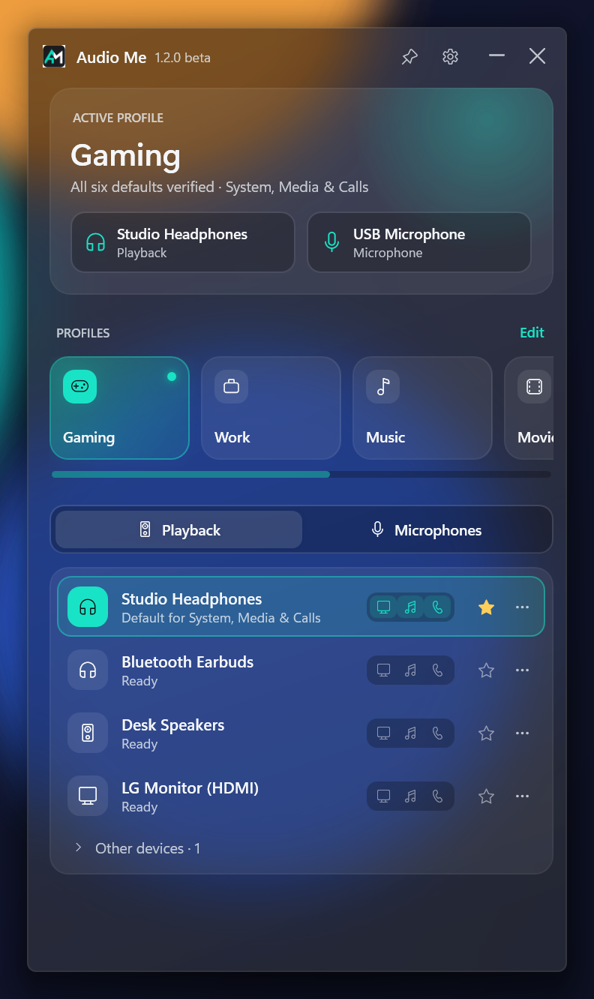
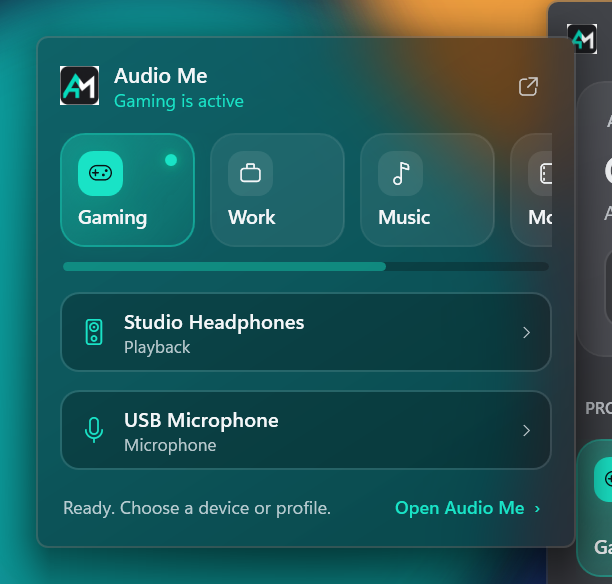
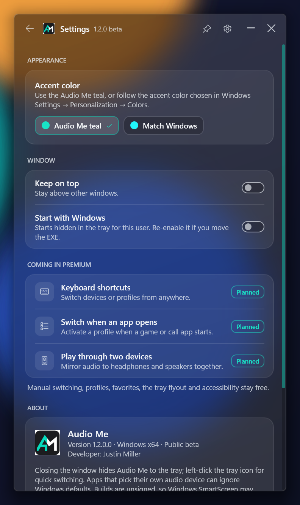
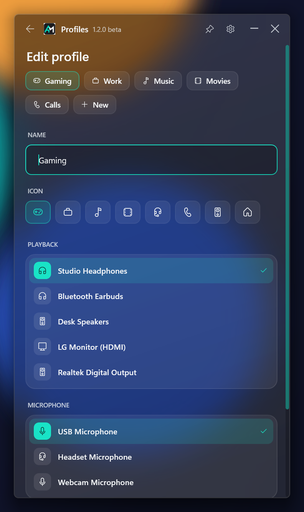

# Audio Me


**A glassy little Windows tray app for switching speakers, microphones and saved audio profiles in one click.**

[](https://buymeacoffee.com/justony5)
[](https://github.com/justony5/audio-me/actions/workflows/build.yml)


Move between gaming, work and casual listening without digging through Windows Sound settings. Pick a device, or activate a profile that selects **one playback device and one microphone**. Audio Me sets and verifies the Windows **System, Media and Calls** defaults for you.

<table>
  <tr>
    <td width="58%"></td>
    <td><br><br><sub><b>Tray flyout.</b> Left-click the tray icon to switch profiles or devices without opening the full window.</sub></td>
  </tr>
  <tr>
    <td colspan="2">
      
      
    </td>
  </tr>
</table>

<sub>Screenshots use demo devices over a stand-in wallpaper. The glass picks up whatever is behind the window on your desktop.</sub>

## What's new in 1.2

- **Windows 11 glass design.** Frosted acrylic surfaces, rounded cards, smooth hover and page animations, and a custom title bar.
- **"Now" card.** Shows the active profile (or *Custom setup*) and the current speaker and microphone at a glance.
- **Profile tiles.** One click to switch. The active tile glows. Disconnected profiles dim with a ⚠ and explain why on hover. With more than three profiles, the row scrolls sideways (mouse wheel works too) on a scrollbar in the app's accent color.
- **Tray quick-switch flyout.** Left-click the tray icon. Right-click still opens the classic menu.
- **Accent color.** Audio Me teal by default, or **Match Windows** to follow the accent in *Settings → Personalization → Colors*. It updates live when you change it, and text contrast adjusts automatically.
- **Profile icons.** Choose one of eight icons, or let Audio Me suggest one from the name.

## Free features

- **Manual playback and microphone switching**, with availability checks, verification of all requested roles, and attempts to restore the previous defaults on failure.
- **Profiles:** create, rename, edit, delete and activate named setups from the main window, the tray flyout or the tray menu.
- **Clear status:** the Now card names a profile only when all six defaults match it. Otherwise it shows *Custom setup*. Disconnected profiles stay visible with a missing-device explanation, and Audio Me never substitutes another device.
- **Favorites and aliases:** ★ sorts favorites to the top. ⋯ → *Rename label* sets a local display name (the full hardware name stays in tooltips).
- **Other devices:** ⋯ → *Move to Other devices* tucks less-used hardware into a collapsible section.
- **Role chips:** monitor, music and phone icons beside each device show which of System, Media and Calls it holds, with tooltips and accessible names.
- **Tray access**, keep-on-top pin, remembered window size, and optional startup with Windows for the current user.
- **Settings recovery:** unreadable settings are never overwritten. Saving pauses until you choose *Back up original and reset*.
- **Keyboard navigation and screen-reader names** throughout, with Esc to go back.

No accounts, payments, telemetry or microphone recording.

## Premium roadmap (planned, not in this build)

Everyday manual switching stays free. Planned premium features:

- **Keyboard shortcuts** to switch or cycle devices and profiles from anywhere.
- **Switch when an app opens:** activate a profile when a game or call app starts, and optionally restore afterwards.
- **Play through two devices:** mirror audio to, for example, headphones and speakers at once (beta; Bluetooth latency means the two outputs won't be perfectly in sync).

A free option to send **calls to a different device** than system and media audio is planned as well.

## Download and run

Requires **Windows 10/11 x64 and .NET Framework 4.8** (included with Windows 11). The glass effect needs Windows 11 22H2 or later with *Transparency effects* on. Otherwise Audio Me uses a solid dark surface.

1. Download the latest `AudioMe-*-win-x64.zip` from [Releases](https://github.com/justony5/audio-me/releases), or from the newest successful [Windows build](https://github.com/justony5/audio-me/actions/workflows/build.yml) run (*Artifacts*).
2. Extract it and run `AudioMe.exe`. No installer or administrator access is needed.
3. The build is **unsigned**, so Windows SmartScreen may show *Windows protected your PC*. Choose *More info → Run anyway* if you trust the download. Each release includes a SHA-256 checksum.

Closing the window hides it to the tray. Left-click the tray icon for the flyout. Right-click it for profiles and **Exit**. `--tray` starts hidden. Settings live at `%LOCALAPPDATA%\AudioSwitch\settings.xml` (the old folder name is kept for compatibility).

## Using profiles

1. Select **New** in the profile row, or **Edit** to manage existing profiles.
2. Enter a name such as **Gaming**, **Work** or **Music**, pick an icon, and explicitly choose its playback device and microphone.
3. Select **Save profile**, then click its tile (in the window or the tray flyout) to switch.

Right-click a tile to edit it. An unavailable profile can't be activated. Editing it keeps the saved device reference until you choose a replacement. Reconnecting the same endpoint makes it available again.

## Compatibility and limitations

- Apps that select their own audio device can ignore Windows defaults. Some sessions need reselecting or restarting.
- Switching uses the undocumented Windows PolicyConfig interface. Discovery and verification use public Core Audio APIs. Windows updates may require compatibility fixes.
- Pair changes are sequential operations, not a single transaction. Restoration is attempted and verified, but can't be guaranteed if a device disappears.
- Device status is polled every two seconds.
- The UI is system-DPI aware. Reopen after changing display scaling.

## Build and validate

From PowerShell in the repository directory:

```powershell
.\build.ps1                                  # .NET Framework compiler; no SDK or NuGet required
.\test.ps1                                   # Connection, preference, migration and settings-recovery tests
.\test-ui.ps1                                # Fake-device UI checks; renders layouts to bin\ui-validation
.\test-ui.ps1 -Screenshots docs\screenshots  # Regenerates README screenshots (briefly shows windows)
.\release.ps1                                # Portable ZIP + SHA-256 in dist\ (does not publish)
```

Exit a running copy before rebuilding. See [docs/ARCHITECTURE.md](docs/ARCHITECTURE.md) for the design.

## Support

Audio Me is free and built in spare time. If it saves you a trip to Sound settings, you can [**buy me a coffee ☕**](https://buymeacoffee.com/justony5). Bug reports and ideas are welcome in [Issues](https://github.com/justony5/audio-me/issues).

## License

The free app is released under the [MIT License](LICENSE). Future premium features will be developed separately.
